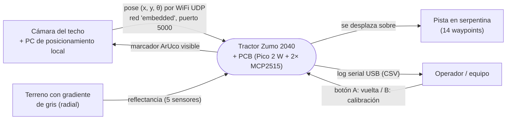
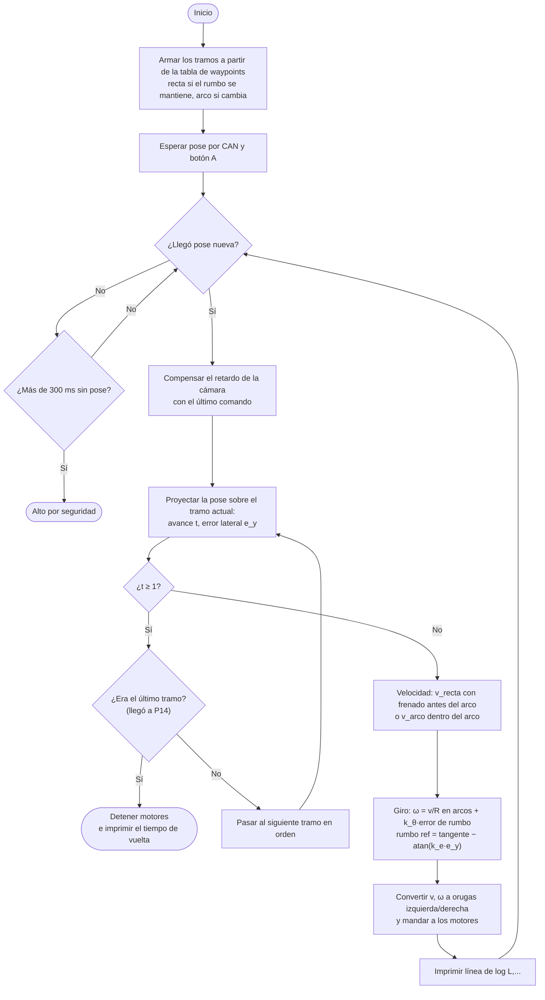

# Second Delivery: documentación para el reporte

Borradores de los diagramas y tablas que pide el reporte. Los diagramas están en Mermaid: GitHub los dibuja directamente, y también se pueden exportar desde [mermaid.live](https://mermaid.live).

## Diagrama de contexto (actualizado)

## Diagrama de despliegue

```mermaid
flowchart LR
    subgraph PC["PC del laboratorio"]
        LP["Software de posicionamiento local<br/>(detección del ArUco)"]
        AP["Hotspot WiFi 'embedded'"]
    end
    subgraph PCB["PCB del tractor"]
        subgraph P2W["Raspberry Pi Pico 2 W"]
            UDP["Listener UDP :5000<br/>(lwIP, cyw43)<br/>filtra el marcador id 4"]
            TXC["LP_POSE 0x100: x, y mm y ángulo 0.1°<br/>int16 big-endian"]
        end
        M1["MCP2515 + TJA1050<br/>(nodo Pico 2 W)"]
        M2["MCP2515 + TJA1050<br/>(nodo Zumo)"]
    end
    subgraph Z["Zumo 2040 (RP2040)"]
        RXC["lp_can.c<br/>decodifica LPdata"]
        FOL["follower.c<br/>seguidor por tramos"]
        MOT["Motores (lib. Pololu)"]
        IR["Sensores de reflectancia<br/>(alpha.c, parte E)"]
    end
    CAMERA["Cámara del techo"] --> LP --> AP
    AP -. "WiFi UDP, JSON ~8/s<br/>{markers: [{id, x, y, angle}]}" .-> UDP --> TXC
    PB["Power bank 5 V"] -- "VBUS: 5 V para los TJA1050" --> P2W
    TXC -- "SPI (GP16–GP20)" --> M1
    M1 == "CAN 500 kbps" ==> M2
    M2 -- "SPI (GP0–GP3, INT GP28)" --> RXC --> FOL --> MOT
```

## Diagrama de actividades: seguimiento de la trayectoria

## Tabla de requisitos (actualizada)

| ID | Requisito | Tipo | Cómo se verifica |
|---|---|---|---|
| R1 | La PCB comunica Pico 2 W y Zumo por CAN a 500 kbps | Funcional | Serial de ambos nodos y repetición de los 50 cm (parte A) |
| R2 | La Pico 2 W recibe la pose (x, y, θ) del marcador 4 por WiFi (~8 por segundo) y la reenvía como LP_POSE (0x100) | Funcional | Serial de la Pico 2 W (`LP ... TX ... OK`) |
| R3 | Los 14 waypoints se guardan en la memoria del Zumo (tabla `WAYPOINTS`) | Funcional | `waypoints.c` y la tabla de tramos que imprime el Zumo al arrancar |
| R4 | El Zumo identifica las vueltas: 5 de 180° y 2 de 90° | Funcional | Tabla de tramos impresa (arco, R, centro, sentido) |
| R5 | La vuelta inicia y termina en P14 | Funcional | Log: `# FIN en P14` |
| R6 | En cada pose nueva el Zumo se ubica en el tramo, elige el siguiente waypoint en orden y actualiza velocidad y giro | Funcional | Log `L,...` (tramo, avance t, e_y) |
| R7 | No se salta waypoints | Funcional | El tramo solo avanza cuando t ≥ 1, en orden |
| R8 | Los giros de 90° se hacen como arcos (R ≈ 7 cm) que mantienen al tractor sobre la pista | Funcional | Gráfica de ruta deseada vs medida |
| R9 | Se detiene si pierde la cámara más de 300 ms (≈2 poses seguidas) | Seguridad | Tapar el marcador → `# ALTO` |
| R10 | Error lateral menor a ±5 cm (la mitad del espacio entre carriles, 14 cm) | Desempeño | Gráfica de ruta vs medida |
| R11 | Vuelta lo más rápida posible (parte D) | Desempeño | Tiempo de 3 vueltas |
| R12 | Se propone y programa un método para medir α con los 5 sensores | Funcional | `alpha/` y prueba en PC |

## Justificación de los waypoints

- **Un waypoint a la entrada y otro a la salida de cada vuelta.** Ahí cambia el tipo de movimiento (recta ↔ arco). Con esos dos puntos y sus rumbos medidos, el Zumo calcula el centro y el radio del arco, así que no hacen falta puntos intermedios.
- **Las rectas no necesitan puntos intermedios.** El seguidor corrige el error lateral contra la línea entre los dos waypoints de los extremos.
- **P14 como inicio y fin.** Está a la entrada de la recta izquierda, la más larga (0.86 m). Ahí el Zumo arranca y acelera alineado, y al terminar la vuelta llega al mismo punto saliendo de una curva a baja velocidad, lo que facilita detenerse.
- **Vueltas de 90°:** P11→P12 (esquina inferior derecha) y P13→P14 (esquina inferior izquierda). **Vueltas de 180°:** P1→P2, P3→P4, P5→P6, P7→P8 y P9→P10.
- **Colocación sin plumón.** Los puntos se ubicaron poniendo el Zumo sobre la pista y leyendo la pose de la cámara (requisito del reto).

| WP | x (m) | y (m) | θ (°) | Papel |
|---|---|---|---|---|
| P1 | −0.36 | 1.09 | 91 | entrada 180° |
| P2 | −0.22 | 1.08 | −90 | salida 180° |
| P3 | −0.21 | 0.40 | −90 | entrada 180° |
| P4 | −0.07 | 0.41 | 90 | salida 180° |
| P5 | −0.07 | 1.09 | 90 | entrada 180° |
| P6 | 0.07 | 1.08 | −90 | salida 180° |
| P7 | 0.08 | 0.40 | −90 | entrada 180° |
| P8 | 0.22 | 0.40 | 90 | salida 180° |
| P9 | 0.22 | 1.08 | 90 | entrada 180° |
| P10 | 0.36 | 1.09 | −90 | salida 180° |
| P11 | 0.35 | 0.22 | −90 | entrada 90° |
| P12 | 0.29 | 0.15 | −180 | salida 90° |
| P13 | −0.28 | 0.16 | −180 | entrada 90° |
| P14 | −0.36 | 0.23 | 90 | salida 90°, **inicio y fin** |

## Parte E: método para medir α

Los pasos y el código están en `../alpha/alpha.h` y `../alpha/alpha.c`. En resumen:

1. Calibrar cada sensor por separado con α = 0 en varios radios. Esto da una tabla t_i(r).
2. Convertir cada lectura a radio r_i con la tabla de su sensor.
3. Usar la geometría: r_i = r0 + s_i·sin α, con s_i = {−45, −10, 0, +10, +45} mm.
4. Ajustar una recta a r_i contra s_i por mínimos cuadrados. La pendiente es sin α.
5. Calcular α = asin(pendiente), en [−90°, 90°].

**Resultado de la prueba (`alpha_test`):** con la calibración actual, que solo tiene 3 radios, el gradiente entre 0.07 y 1.0 m es de apenas 11–27 µs/m. A lo ancho de la fila de sensores eso da menos de 1.2 µs, por debajo del ruido (3–6 µs). A partir de r ≈ 1.3 m la simulación da α con ±4–5° de desviación (±10° cerca de 90°). **Falta medir la tabla t_i(r) en más radios** para saber la pendiente real de la curva.
